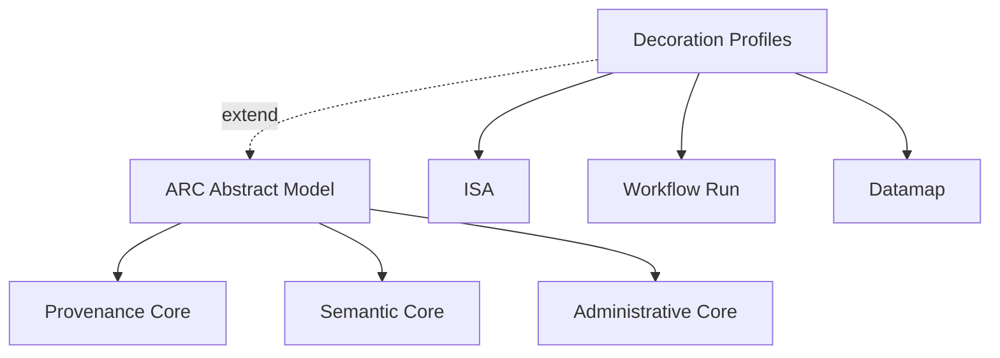

# ARC Abstract Model

Specification and implementation workspace for the ARC Abstract Model. The model is
organized into three profiles—Provenance Core, Semantic Core,
and Administrative Core—and domain-specific decoration profiles that extend them.
The repository also contains derived schema representations, examples, and F#
libraries for working across .NET, JavaScript, and Python runtimes.

## Start Here

- [Project overview](project/overview.md)
- [Abstract Model](spec/index.md)
- [Decoration profiles](spec/decorations/overview.md)
- [Specification guide](project/specification.md)
- [Implementation guide](project/implementation.md)
- [ARC Abstract Model Layer 1 guide](project/abstract-model.md)
- [PolyglotSQLite guide](project/polyglot-sqlite.md)
- [Examples and schemas](project/examples-and-schemas.md)
- [Reference material](project/references.md)
- [Prior art notes](project/prior-art.md)

## Profile Overview

